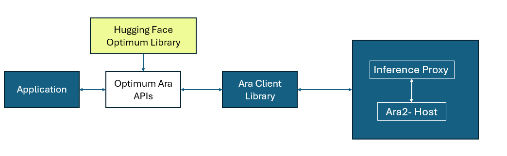

<div align="center">

# Optimum Ara

[](LICENSE.txt)
[](https://www.python.org/downloads/release/python-31013/)


---

<div align="left">

## Table of Contents

- [Optimum Ara](#optimum-ara)
  - [Table of Contents](#table-of-contents)
  - [Supported Models](#supported-models)
    - [Llama Family](#llama-family)
    - [Qwen2 Family](#qwen2-family)
    - [Qwen2.5 Family](#qwen25-family)
    - [Qwen3 Family](#qwen3-family)
  - [Optimum-Ara Architecture](#optimum-ara-architecture)
  - [Prerequisite](#prerequisite)
  - [Install Optimum Ara from Source](#install-optimum-ara-from-source)
  - [Generate Wheel Package](#generate-wheel-package)
  - [Set up Optimum Ara in i.MX Platforms](#set-up-optimum-ara-in-imx-platforms)
  - [Run Example with Optimum-Ara](#run-example-with-optimum-ara)
  - [API Documentation](#api-documentation)
  - [Examples](#examples)
  - [Release Notes](#release-notes)
  - [License](#license)

---

Optimum Ara is an extension of the [Hugging Face Transformers](https://huggingface.co/docs/transformers/index) and Optimum ecosystem that adds support for the Ara DNPU, enabling high-performance AI inference at the edge. It provides Python APIs that mirror familiar Transformers patterns, such as `AutoModelForCausalLM`, `AutoModelForImageTextToText`, and related classes, while offloading model execution to Ara hardware through compiled .dvm model binaries.

By importing `optimum.ara`, Ara DNPU specific model and configuration classes are registered with Transformers auto-classes. The library then manages session creation, endpoint communication, and generation, allowing applications to run optimized inference with minimal changes to standard Hugging Face workflows.

## Supported Models

The following models are integrated into the `optimum-ara` library:

### Llama Family

| Model                 | Type | Task            | model_type |
| :-------------------- | :--- | :-------------- | :--------- |
| Llama-2-7B            | LLM  | Text Generation | ara_llama  |
| Llama-3.1-8B-Instruct | LLM  | Text Generation | ara_llama  |
| Llama-3.2-3B-Instruct | LLM  | Text Generation | ara_llama  |

### Qwen2 Family

| Model             | Type | Task            | model_type |
| :---------------- | :--- | :-------------- | :--------- |
| Qwen2-7B-Instruct | LLM  | Text Generation | ara_qwen   |

### Qwen2.5 Family

| Model                       | Type | Task                                     | model_type          | NXP HF Hub |
| :-------------------------- | :--- | :--------------------------------------- | :------------------ | :----------|
| Qwen2.5-3B-Instruct         | LLM  | Text Generation                          | ara_qwen            |            |
| Qwen2.5-7B-Instruct         | LLM  | Text Generation                          | ara_qwen            | [nxp/Qwen2.5-7B-Instruct-Ara240](https://huggingface.co/nxp/Qwen2.5-7B-Instruct-Ara240)          |
| Qwen2.5-Coder-1.5B-Instruct | LLM  | Text Generation                          | ara_qwen            | [nxp/Qwen2.5-Coder-1.5B-Ara240](https://huggingface.co/nxp/Qwen2.5-Coder-1.5B-Ara240) |
| Qwen2.5-VL-3B-Instruct      | VLM  | Image-Text-to-Text                       | ara_qwen_image      |            |
| Qwen2.5-VL-3B-Instruct      | VLM  | Video-Text-to-Text                       | ara_qwen_vl         |            |
| Qwen2.5-VL-3B-Instruct      | VLM  | Image-Text-to-Text<br>Video-Text-to-Text | ara_qwen_multimodal |            |
| Qwen2.5-VL-7B-Instruct      | VLM  | Image-Text-to-Text                       | ara_qwen_image      | [nxp/Qwen2.5-VL-7B-Instruct-Ara240](https://huggingface.co/nxp/Qwen2.5-VL-7B-Instruct-Ara240)           |
| Qwen2.5-VL-7B-Instruct      | VLM  | Video-Text-to-Text                       | ara_qwen_vl         |            |
| Qwen2.5-VL-7B-Instruct      | VLM  | Image-Text-to-Text<br>Video-Text-to-Text | ara_qwen_multimodal |            |

### Qwen3 Family

| Model                | Type | Task                                     | model_type           |
| :------------------- | :--- | :--------------------------------------- | :------------------- |
| Qwen3-0.6B           | LLM  | Text Generation                          | ara_qwen             |
| Qwen3-4B             | LLM  | Text Generation                          | ara_qwen             |
| Qwen3-8B             | LLM  | Text Generation                          | ara_qwen             |
| Qwen3-VL-2B-Instruct | VLM  | Image-Text-to-Text                       | ara_qwen3_image      |
| Qwen3-VL-2B-Instruct | VLM  | Video-Text-to-Text                       | ara_qwen3_vl         |
| Qwen3-VL-2B-Instruct | VLM  | Image-Text-to-Text<br>Video-Text-to-Text | ara_qwen3_multimodal |

## Optimum-Ara Architecture



## Prerequisite

> Note: Please make sure you have the Ara DNPU Runtime software stack installed and configured on your system before proceeding with the installation of Optimum Ara. Ara240 DNPU module must also be connected to your platform.

1. Configure the Ara Runtime by setting the SDK root directory. If you are using an i.MX platform that already has the Ara DNPU Runtime software stack pre-installed, this step is not required and you can skip to [Set it up in i.MX Platforms](#set-it-up-in-imx-platforms) section. Otherwise, set the environment variable:

   ```bash
   export DV_TGT_ROOT=<sdk root path>
   ```

1. Start the Ara DNPU proxy:

   ```bash
   # For x86 platforms:
   cd $DV_TGT_ROOT/art/linux/x86/proxy/
   ./proxy_x86_64 -c ../../config/proxy_config.yaml

   # For aarch64 platforms:
   cd $DV_TGT_ROOT/art/linux/aarch64/proxy/
   ./proxy_aarch64 -c ../../config/proxy_config.yaml
   ```

## Install Optimum Ara from Source

> Note: Python Virtual Environment is recommended to avoid conflicts with exisiting packages.

Clone this repository in your target platform. You can choose the version to download. We recommend using `uv` for ease of use and faster installation than `pip`. To install `uv`, follow steps from [Installation | uv](https://docs.astral.sh/uv/getting-started/installation/):

```bash
# Below command fetches Optimum Ara v1.1.1. Change this version depending on the SDK you are using
git clone https://github.com/NXP/Optimum-Ara.git -b v1.1.1
cd optimum-ara

# Create venv using uv:
uv venv

# To install for usage
uv pip install .
# To install for development
uv pip install -e .
```

## Generate Wheel Package

1. The following commands will generate a wheel package in the `./dist` directory. You can install the wheel package on your target platform if Git is not available (such is the case of default i.MX BSP):

   ```bash
   uv venv
   uv build
   ```

1. Copy the wheel package to the platform you want to use and install it there with below command:

   ```bash
   # Make sure you have uv installed in the platform, or use pip instead
   uv venv
   uv pip install optimum_ara-<version>.whl
   ```

## Set up Optimum Ara in i.MX Platforms

Optimum-Ara and Ara DNPU Runtime software stack is part of the official i.MX Embedded Linux BSP starting `LF6.18.20_2.0.0` (June 2026). Please check the [Release Notes](https://docs.nxp.com/bundle/RN00543/page/topics/overview.html) to see which i.MX platforms are supported. If you want to install the included Optimum-Ara wheel in your i.MX platform, follow the instructions below:

1. Flash the BSP to an i.MX platform that officially supports Ara240 DNPU. To get the officially released pre-built BSPs go to: [Embedded Linux for i.MX Applications Processors | NXP Semiconductors](https://www.nxp.com/design/design-center/software/embedded-software/i-mx-software/embedded-linux-for-i-mx-applications-processors:IMXLINUX). If you want to build your own BSP, please follow the instructions in [i.MX Yocto Project User's Guide](https://www.nxp.com/docs/en/user-guide/UG10164.pdf). To flash the BSP, follow the instructions in [i.MX Linux User's Guide](https://www.nxp.com/docs/en/user-guide/UG10163.pdf).

1. Ensure the Ara DNPU module is connected to the i.MX platform through PCIe M.2 or USB. Boot up the board and wait for the Ara DNPU proxy is up and running. You should see below logs:

   ```plain
    [74.657320] bash[1135]: 2026-03-13 15:36:17 - Proxy launched succesfully
    [75.689777] bash[1143]: 2026-03-13 15:36:18 - Hardware bringup completed and proxy is launched successfully in the background.
   ```

1. The pre-built wheel binary is located at `/usr/share/python-wheels/`. Name of wheel will change depending on the version of Optimum-Ara included in the BSP.

1. Install Optimum-Ara. Make sure your i.MX platform has access to internet, and its date and time are correct. Otherwise, it will fail to fetch scripts from servers due to SSL certificate issues. It is recommended to install Optimum-Ara in a virtual environment. We recommend using uv, but native python venv is also supported. Below are steps using uv. Please ensure you add the `--no-progress` argument for faster installation:

   ```bash
   # Use curl to download uv script and execute with sh:
   curl -LsSf https://astral.sh/uv/install.sh | sh
   # Run below command to be able to use uv without restarting your shell:
   source $HOME/.local/bin/env

   # Create your venv
   uv venv
   # Install Optimum-Ara
   uv pip install --no-progress /usr/share/python-wheels/optimum_ara-1.1.0-py3-none-any.whl
   ```

## API Documentation

Optimum Ara provides configuration and model classes inspired by Hugging Face Transformers.

For more info check [API Documentation](./docs/optimum-ara-apis.md).

## Run Example with Optimum-Ara

Examples provide a quick way to start using Optimum Ara.

For more info check the [README.md](./examples/Readme.md) inside of `examples/`.

## Release Notes

| Optimum-Ara | Ara SDK | i.MX BSP         | Notes                  |
| ----------- | ------- | ---------------- | ---------------------- |
| 1.0.0       | r2.1.1  | lf-6.18.20_2.0.0 | i.MX BSP Q2'26 Release |
| 1.0.1       | r2.1.1  | -                | Hot fix release        |
| 1.1.0       | r3.0    | lf-6.18.37_2.1.0 | i.MX BSP Q3'26 Release |
| 1.1.1       | r3.0    | -                | Hot fix release        |

## License

Optimum Ara is licensed under the [Apache-2.0](LICENSE.txt) license.