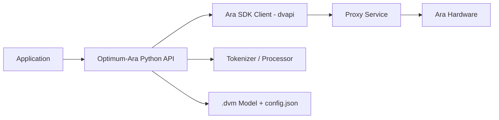

# Introduction to Optimum-Ara

## What is Optimum-Ara?

Optimum-Ara is an extension of the [Hugging Face Transformers](https://huggingface.co/docs/transformers) and Optimum ecosystem that adds support for the **Ara accelerator**, enabling high-performance AI inference at the edge. It provides Python APIs that mirror familiar Transformers patterns—`AutoModelForCausalLM`, `AutoModelForImageTextToText`, and related classes—while offloading model execution to Ara hardware through compiled `.dvm` model binaries.

By importing `optimum.ara`, Ara-specific model and configuration classes are registered with Transformers auto-classes. The library then handles session management, endpoint communication, and generation, so applications can run optimized inference with minimal changes to standard Hugging Face workflows.

Supported model families include:

| Model               | Variants           | model_type           |
| :------------------ | :----------------- | -------------------- |
| Llama 2             | 7B                 | ara_llama            |
| Llama 3.1           | 8B                 | ara_llama            |
| Llama 3.2           | 3B                 | ara_llama            |
| Qwen 2              | 7B                 | ara_qwen             |
| Qwen 2.5            | coder-1.5B, 3B, 7B | ara_qwen             |
| Qwen 2.5 Image      | 3B, 7B             | ara_qwen_image       |
| Qwen 2.5 VL (video) | 3B, 7B             | ara_qwen_vl          |
| Qwen 2.5 Multimodal | 3B, 7B             | ara_qwen_multimodal  |
| Qwen 3              | .6B, 4B, 8B        | ara_qwen             |
| Qwen 3 Multimodal   | 2B                 | ara_qwen3_multimodal |
| Llava               | 8B                 | ara_llava            |
| Whisper             | Medium             | ara_whisper          |

For API details, see [Optimum-Ara APIs](./optimum-ara-apis.md).

---

## Typical Design Flow / User Flow

Optimum-Ara follows a host-to-accelerator architecture. A Python application on the host uses the Optimum-Ara library to communicate with Ara hardware via a proxy service and the Ara SDK client library (`dvapi`).



### End-to-end workflow

1. **Hardware bring-up** — Ensure the Ara device is set up and accessible on the network or via a local socket interface. Bring-up steps are provided separately with the Ara hardware and SDK documentation.

2. **Install Optimum-Ara** — Install the Python package from a wheel, the git repository, or a BSP image (see [Release Methods](#release-methods-and-locations) below).

3. **Configure the Ara SDK** — Point the environment to the SDK root and start the proxy service that bridges the host application to the accelerator.

4. **Prepare model assets** — Obtain a compiled `.dvm` model file along with `config.json` and `generation_config.json`. Set the `dvm_path`, `interface_type`, `interface_ip_address`, `interface_port`, and `interface_socket_file` parameters in the `ara` section of `config.json`.

5. **Load and run inference** — Use standard Transformers auto-classes after importing `optimum.ara`:

   ```python
   import optimum.ara
   from transformers import AutoTokenizer, AutoModelForCausalLM
   from optimum.ara import AraGenerationConfig

   model = AutoModelForCausalLM.from_pretrained("models/llama2-7b")
   tokenizer = AutoTokenizer.from_pretrained("meta-llama/Llama-2-7b-chat-hf")
   generation_config = AraGenerationConfig.from_pretrained("models/llama2-7b")

   inputs = tokenizer("Hello, how are you?", return_tensors="pt")
   output = model.generate(**inputs, generation_config=generation_config)
   ```

6. **Iterate and integrate** — Start from the [examples](../examples/Readme.md) for text, vision, and audio tasks; use the [testapp](../testapp/README.md) for validation; or build a custom application or Gradio UI via [examples_gui](../examples_gui/README.md).

At runtime, Optimum-Ara:

- Reads model configuration from `config.json` (including Ara-specific `ara` parameters).
- Creates an SDK session and connects to the proxy using the configured interface type (`SOCKET` or `IPV4`).
- Loads the `.dvm` model onto the accelerator.
- Runs tokenization/preprocessing on the host and sends inference requests to Ara hardware for generation.

---

## Getting Started

### Prerequisites

| Requirement           | Details                                                                                  |
| :-------------------- | :--------------------------------------------------------------------------------------- |
| **Hardware**          | Ara accelerator with hardware bring-up completed                                         |
| **Python**            | Version >= 3.10 (virtual environment recommended)                                        |
| **Ara SDK**           | Runtime SDK providing `dvapi`, client libraries, and the proxy service                   |
| **Model assets**      | Compiled `.dvm` file, `config.json`, `generation_config.json`, and a tokenizer/processor |
| **Host architecture** | x86_64 or aarch64 Linux                                                                  |

### Setup steps

1. **Install Optimum-Ara**

   From a built wheel:

   ```bash
   cd <sdk>/art/linux/optimum-ara/
   pip install optimum_ara-<version>.whl --extra-index-url https://download.pytorch.org/whl/cpu
   ```

   From source (development):

   ```bash
   git clone https://github.com/NXP/Optimum-Ara.git
   cd Optimum-Ara
   pip install -e ".[dev]" --extra-index-url https://download.pytorch.org/whl/cpu
   ```

2. **Configure the SDK**

   Set the SDK root directory. If the SDK is installed at the default BSP path (`/usr/share/rt-sdk-ara240`), this step may not be required.

   ```bash
   export DV_TGT_ROOT=<sdk root path>
   ```

3. **Start the proxy**

   ```bash
   cd $DV_TGT_ROOT/art/linux/x86/proxy/
   ./proxy -c ../../config/proxy_config.yaml
   ```

   On aarch64 target systems, use the corresponding `art/linux/aarch64/proxy/` path instead.

4. **Prepare model configuration**

   Update `dvm_path` in `models/<model_name>/config.json` to point to your compiled model, and ensure `interface_type`, `interface_socket_file` (or `interface_ip_address` / `interface_port`) match the proxy configuration.

5. **Run an example**

   ```bash
   python examples/causalLM.py
   ```

   For Hugging Face Hub tokenizers (e.g., Llama), log in first:

   ```bash
   pip install -U huggingface_hub
   huggingface-cli login
   ```

For model assets published on Hugging Face Hub under the `nxp/` organization, Optimum-Ara can download `.dvm` files automatically when loading models by Hub ID (e.g., `nxp/Qwen2.5-Coder-1.5B-Ara240`). The download is triggered when no local `.dvm` file is found and the model ID starts with `nxp/`. The file is cached under `/usr/share/llm/<model_name>/` using `huggingface_hub.hf_hub_download`.

---

## Release Methods and Locations

Optimum-Ara and its dependencies are distributed through three complementary channels. Choose the one that matches your role and deployment target.

### Git repository

**Location:** [https://github.com/NXP/Optimum-Ara](https://github.com/NXP/Optimum-Ara)

**Contents:** Python library source code, examples, documentation, model configuration templates, tests.

**When to use:**

- Application development and integration
- Contributing changes or running unit tests
- Exploring example scripts and API documentation
- Building a custom wheel (`python -m build` produces packages in `./dist`)

The git repository does **not** include the Ara SDK, compiled `.dvm` model binaries, or hardware runtime components. Those come from the SDK or BSP.

### SDK folder

**Location:** Ara runtime SDK, referenced via `DV_TGT_ROOT` or the default path `/usr/share/rt-sdk-ara240`.

**Contents:**

- `art/linux/<arch>/include/dvapi.py` — Python client API loaded dynamically by Optimum-Ara
- `art/linux/<arch>/lib/` — Client libraries (`libaraclient_*.so`)
- `art/linux/<arch>/proxy/` — Proxy service executable and configuration
- `art/config/` — Proxy and platform configuration files

**When to use:**

- Any host-side development or inference session (x86_64 or aarch64)
- Running the proxy service that connects Python applications to Ara hardware
- CI, validation, and lab environments where the SDK is installed separately from the Python library

Optimum-Ara depends on the SDK at import time. If neither the default BSP path nor `DV_TGT_ROOT` is set, the library raises `EnvironmentError("Default SDK path does not exist and DV_TGT_ROOT environment variable not set")` at import time.

### BSP (Board Support Package)

**Location:** Pre-integrated platform image for target hardware, typically installing the SDK at `/usr/share/rt-sdk-ara240` and model assets under paths such as `/usr/share/llm/`.

**Contents:** Full platform software stack for embedded deployment, including the Ara SDK, drivers, proxy, and optionally pre-installed Optimum-Ara packages and model binaries.

**When to use:**

- On-device / edge deployment on aarch64 target boards
- Production environments where SDK paths and services are pre-configured
- Scenarios where you want a turnkey stack without manually assembling SDK, proxy, and Python dependencies

### Comparison

| Aspect                         | Git Repository          | SDK Folder                     | BSP                             |
| :----------------------------- | :---------------------- | :----------------------------- | :------------------------------ |
| **Primary audience**           | Developers              | All runtime users              | Embedded / production deployers |
| **Optimum-Ara Python package** | Source / build yourself | Not included                   | Often pre-installed             |
| **Ara SDK & proxy**            | Not included            | Included                       | Included (pre-configured)       |
| **Model `.dvm` binaries**      | Config only             | Not included                   | May be pre-installed            |
| **Typical host**               | Dev machine             | Dev or lab host                | Target board (aarch64)          |
| **Configuration**              | Manual setup            | Set `DV_TGT_ROOT`, start proxy | Default paths, minimal setup    |

In practice, most developers clone or install from the **git repository** (or a wheel built from it), pair it with the **SDK** for runtime connectivity, and deploy to production using a **BSP** image on the target device.

---

## Folder Structure

```
Optimum-Ara/
├── optimum/ara/              # Core Python library
│   ├── api/                  # SDK integration (Core, dvapi loader, exceptions)
│   ├── generation/           # AraGenerationConfig, custom logits processors
│   ├── models/               # Model-specific implementations (Llama, Qwen, Llava, Whisper, …)
│   ├── pipelines/            # Pipeline base classes
│   └── utils/                # Configuration, file utilities, constants
├── docs/                     # API and class documentation
│   ├── assets/               # Architecture diagrams and images
│   ├── base_classes/         # Base class reference (AraModelForCausalLM, configs, …)
│   ├── models/               # Per-model API documentation
│   ├── introduction.md       # This document
│   └── optimum-ara-apis.md     # Top-level API overview
├── examples/                 # Command-line example scripts (text, vision, audio)
├── examples_gui/             # Gradio-based multimodal demo and tests
├── models/                   # Model config templates (config.json, generation_config.json)
│   ├── llama2-7b/
│   ├── llama3.1-8b/
│   ├── qwen2_7b/
│   ├── qwen2.5-vl-3B/
│   ├── llava/
│   ├── whisper/
│   └── …
├── testapp/                  # CLI test harness for batch/single-prompt validation
├── tests/                    # Unit and integration tests
├── val_cfg/                  # Validation configuration for CI test runs
├── ci/                       # Jenkins pipelines and CI utilities
├── scripts/                  # Utility scripts
├── README.md                 # Build, install, and prerequisite instructions
├── pyproject.toml            # Package metadata and dependencies
└── CHANGE_NOTES.md           # Release notes for API changes
```

### Key directories

| Directory       | Purpose                                                                                                                                                                                                                                              |
| :-------------- | :--------------------------------------------------------------------------------------------------------------------------------------------------------------------------------------------------------------------------------------------------- |
| `optimum/ara/`  | Library source—the entry point is `import optimum.ara`, which registers Ara classes with Transformers and loads the SDK `dvapi` module.                                                                                                              |
| `docs/`         | Reference documentation for APIs, base classes, and model-specific classes.                                                                                                                                                                          |
| `models/`       | Per-model directories containing `config.json` and `generation_config.json`. Each `config.json` includes an `ara` block with `dvm_path` and proxy interface settings. Actual `.dvm` binaries are placed locally or downloaded from Hugging Face Hub. |
| `examples/`     | Minimal scripts demonstrating text generation, vision-language, and speech tasks.                                                                                                                                                                    |
| `examples_gui/` | Interactive Gradio web UI for multimodal model testing.                                                                                                                                                                                              |
| `testapp/`      | Structured testing tool with JSON configuration, batch prompts, and golden-output comparison.                                                                                                                                                        |
| `tests/`        | Pytest suite; requires `DV_TGT_ROOT` for hardware-connected tests.                                                                                                                                                                                   |
| `scripts/`      | Utility scripts for development and CI tasks.                                                                                                                                                                                                        |
| `ci/`           | Jenkins pipeline definitions and CI configuration.                                                                                                                                                                                                   |
| `val_cfg/`      | Validation configuration files used by CI test runs.                                                                                                                                                                                                 |

---

## Next Steps

- [README](../README.md) — Installation, dependencies, and prerequisites
- [Optimum-Ara APIs](./optimum-ara-apis.md) — Supported auto-classes and configuration
- [Examples](../examples/Readme.md) — Running text, image, video, and audio demos
- [Base Classes](./base_classes/base_classes.md) — Core configuration and model base classes
